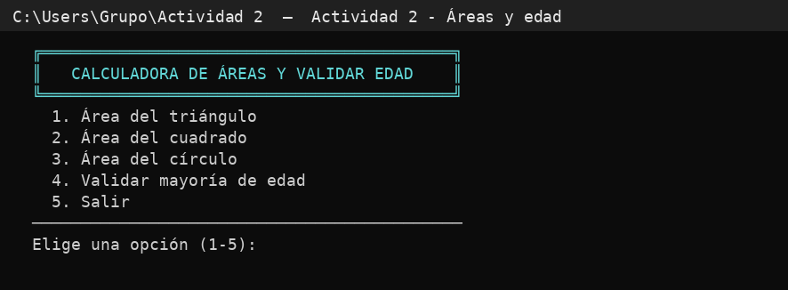
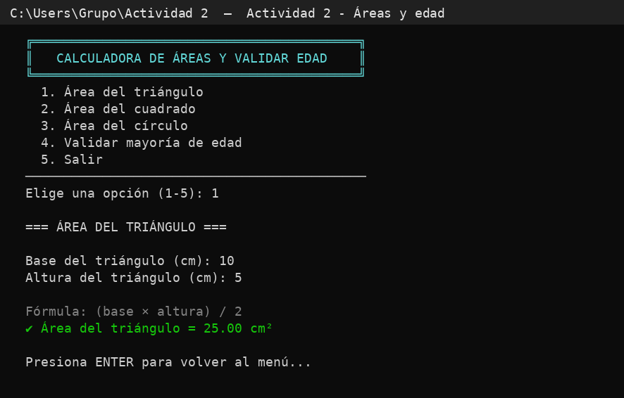
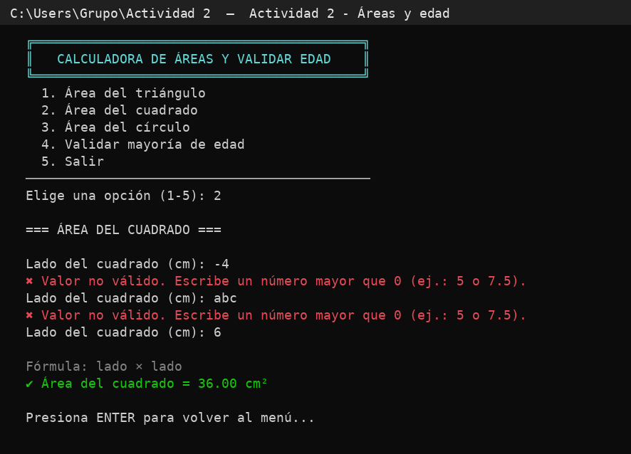
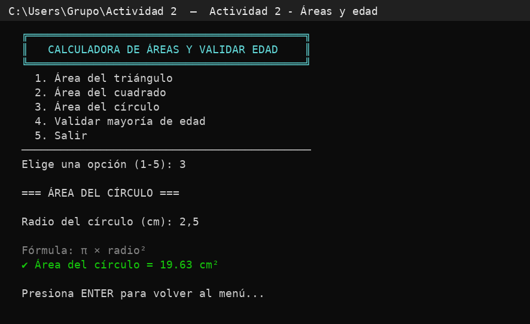
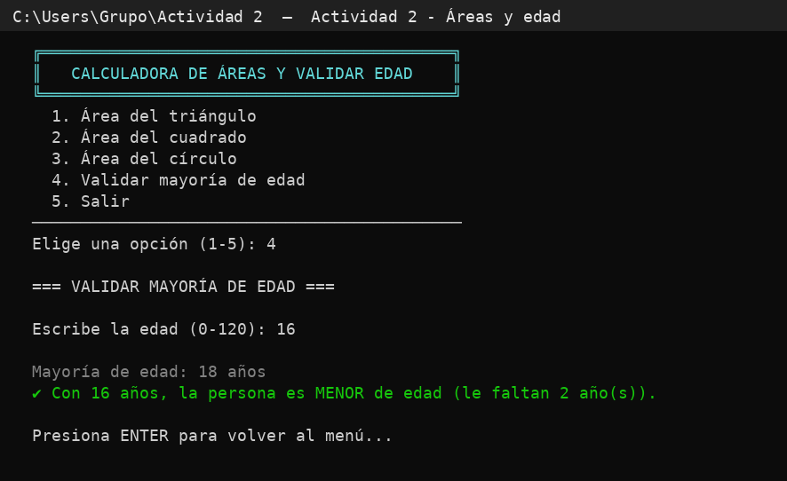
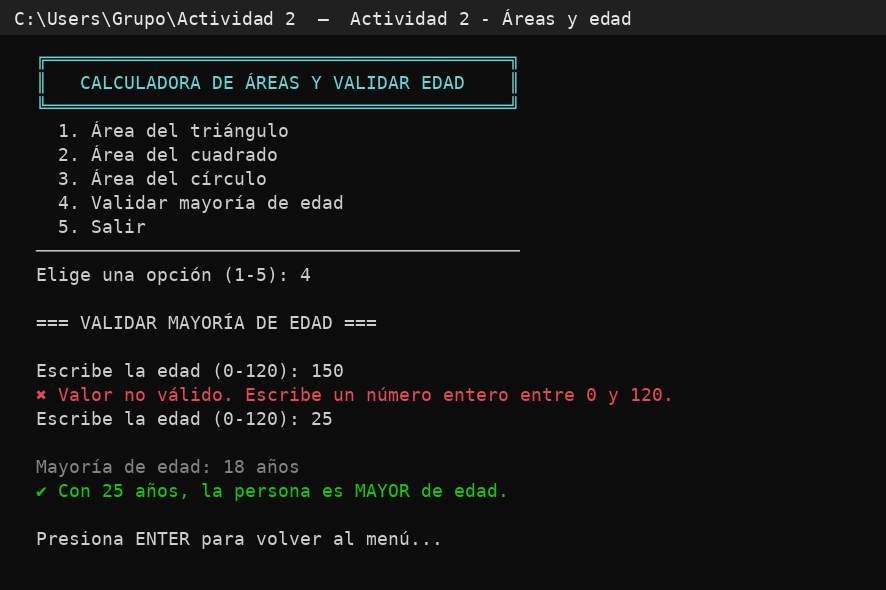
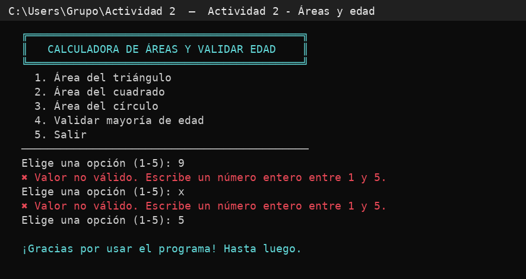

# Actividad 2 – Calculadora de áreas y validador de edad (C#)

**Asignatura:** Algoritmos Computacionales
**Profesor:** Gamalier Reyes del Carmen
**Universidad:** Universidad O&M

## Autores

| Nombre completo | Matrícula |
|---|---|
| Roger Ciprián Scroggin | 26-ESON-2-012 |
| Laudy Mejía | 25-MISN-2-011 |
| Dean Boris Georges Trubina | 26-EISN-2-042 |
| Wilfy Paulino Martínez | 21-EISN-2-042 |
| Daniel Antonio Mañón | 26-ESON-2-015 |
| Albhery Severino | 25-EISN-2-048 |

## Descripción

Aplicación de consola en C# que muestra un menú con cinco opciones. Con ella el usuario puede calcular el **área de un triángulo, de un cuadrado y de un círculo**, y averiguar si una persona es **mayor o menor de edad**.

Cada cálculo está en su propia **función**. La función recibe los datos por **parámetros** y **retorna** el resultado. El programa principal (`Main`) pide los valores al usuario, llama a esas funciones y muestra en pantalla lo que retornan.

Para que sea fácil de usar, el programa:
- usa colores: los resultados salen en verde y los errores en rojo;
- muestra la fórmula que se aplicó;
- valida cada dato, así que no se cierra si el usuario escribe letras o números negativos;
- acepta punto o coma como separador decimal (`2.5` o `2,5`);
- vuelve al menú después de cada operación hasta que el usuario elige **Salir**.

## Datos de entrada

| Opción | Datos que pide | Validación |
|---|---|---|
| Menú | Opción del 1 al 5 | Número entero entre 1 y 5 |
| 1. Triángulo | Base y altura (cm) | Números mayores que 0 |
| 2. Cuadrado | Lado (cm) | Número mayor que 0 |
| 3. Círculo | Radio (cm) | Número mayor que 0 |
| 4. Edad | Edad en años | Número entero entre 0 y 120 |

## Datos que procesa

| Función | Parámetros | Retorna | Proceso |
|---|---|---|---|
| `CalcularAreaTriangulo` | `double baseTriangulo, double altura` | `double` | (base × altura) / 2 |
| `CalcularAreaCuadrado` | `double lado` | `double` | lado × lado |
| `CalcularAreaCirculo` | `double radio` | `double` | π × radio² (usa `Math.PI`) |
| `ValidarEdad` | `int edad` | `string` | Si edad ≥ 18 es mayor de edad; si no, es menor y calcula cuántos años le faltan |

Funciones de apoyo (procedimientos):
- `LeerNumeroPositivo` y `LeerEntero` leen los datos con `TryParse` y un ciclo `do-while` hasta que el valor es válido.
- `MostrarMenu`, `MostrarTitulo`, `MostrarResultado` y `MostrarError` muestran la información en pantalla.

## Datos de salida

- El área de la figura con 2 decimales y en cm², junto con la fórmula usada.
- Un mensaje que dice si la persona es **MAYOR** o **MENOR** de edad. Si es menor, también dice cuántos años le faltan.
- Mensajes de error en rojo cuando un dato no es válido.

## Capturas de pantalla

**1. Menú principal**



**2. Área del triángulo (base 10, altura 5)**



**3. Área del cuadrado: valida un número negativo y letras antes de calcular**



**4. Área del círculo (radio 2,5 escrito con coma)**



**5. Validar edad: menor de edad (16 años)**



**6. Validar edad: rechaza 150 y luego acepta 25 (mayor de edad)**



**7. Opción de menú no válida y salida del programa**



## Cómo ejecutarlo

1. Abre `Actividad 2.slnx` en Visual Studio 2026, o cualquier versión que tenga el **.NET 10 SDK**.
2. Presiona **F5** o **Ctrl + F5**.

También se puede ejecutar desde una terminal, dentro de la carpeta del repositorio:

```
dotnet run --project "Actividad 2"
```

## Tecnología

- Lenguaje: C#
- Plataforma: .NET 10 (aplicación de consola)
- Entorno: Visual Studio
- Control de versiones: Git y GitHub
